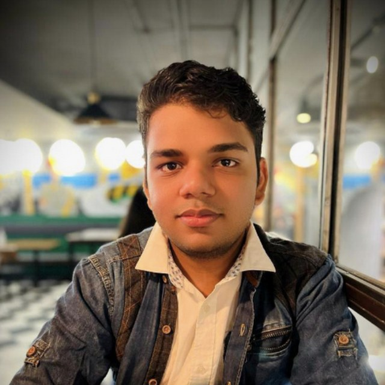

<section class="hero" aria-label="About">
    

        <picture>
            <source srcset="/images/nomaan.webp" type="image/webp">
            
        </picture>
    

    

        <h1>Nomaan Qureshi</h1>
        
Hi! I am a Research Engineer at <a href="https://skild.ai">Skild AI</a>, working on advancing robotics and AI. I completed my MS in Robotics at Carnegie Mellon University, where I was advised by <a href="https://www.ri.cmu.edu/ri-faculty/george-a-kantor/">Prof. George Kantor</a> and <a href="https://www.abhisilwal.com">Prof. Abhisesh Silwal</a>, and collaborated with <a href="https://davheld.github.io">Prof. David Held</a> and <a href="https://www.ri.cmu.edu/ri-people/francisco-yandun/">Dr. Francisco Yandun</a>. My interests broadly span robotics, machine learning, and building systems that support real-world applications. Previously, I worked on <a href="https://splatsim.github.io">SplatSim</a> and deployed robots in challenging real-world environments.

        
Before that, I completed my integrated BS degree from <a href="https://csrankings.org/#/index?ai&vision&mlmining&nlp&inforet&robotics&in">IIIT Hyderabad</a>. I was an undergraduate researcher at Robotics Research Center, advised by <a href="https://scholar.google.co.in/citations?user=QDuPGHwAAAAJ&hl=en">Prof. K. Madhava Krishna.</a> I spent my summers of 2021 and 2022 working with Prof. David Held at Carnegie Mellon University. I formulated a <a href="/papers/deep-sequenced-linear-dynamical-systems/">differentiable version of linear dynamic systems</a>, which could be used as a building block to accelerate the learning and transfer of policies. I also collaborated with <a href="https://makarandtapaswi.github.io">Prof. Makarand Tapaswi</a> on a <a href="/papers/skills-from-video-differentiable-physics/">project</a> that aims to learn manipulation policies directly from human demonstrations like <a href="https://paperswithcode.com/dataset/something-something-v2">these.</a>

        
If you're looking for collaborators for Robotics/ML projects, please feel free to get in touch!

        

            <a class="tlink" href="/resume.pdf">CV</a>
            <a class="tlink" href="https://scholar.google.com/citations?user=ZmVf8kUAAAAJ&hl=en&sortby=pubdate">Google Scholar</a>
            <a class="tlink" href="https://github.com/qureshinomaan">GitHub</a>
            <a class="tlink" href="https://www.linkedin.com/in/qureshinomaan/">LinkedIn</a>
            <a class="tlink" href="https://twitter.com/qunomaan">Twitter</a>
            <a class="tlink" href="mailto:nqafzal@gmail.com">Email</a>
        

    

</section>

<section class="section" id="research">
    <h2>Research</h2>
    
I want to solve robot manipulation. While most animals can walk or run, very few can manipulate their environments like humans do. There is an inherent simplicity yet profound intrigue in manipulation problems that captivates me.

</section>

<section class="section" id="news">
    <h2>News</h2>
    <ul class="news">
        <li><time>Jan 2025</time><a href="/papers/splatsim/">SplatSim</a> accepted at ICRA 2025!</li>
        <li><time>Sep 15, 2024</time>Submitted <a href="https://splatsim.github.io">SplatSim</a> to ICRA 2025!</li>
        <li><time>Jun 30, 2024</time><a href="/papers/imagine2servo/">Imagine2Servo</a> accepted at IROS 2024!</li>
        <li><time>Sep 09, 2023</time>Teaching Assistant for <a href="https://16-831.github.io/fall23/">Robot Learning Course</a>!</li>
        <li><time>Sep 09, 2023</time>Our <a href="/papers/time-indexing/">paper</a> on time-based inductive bias for RL policies got accepted to an IROS Workshop!</li>
    </ul>
    

        
Earlier news

        <ul class="news">
            <li><time>Aug 14, 2023</time>Started MS Robotics at CMU!</li>
            <li><time>Apr 07, 2023</time>Our <a href="/papers/arc-length-value-function/">paper</a> on data-driven inverse kinematics got accepted to IJCNN, 2023!</li>
            <li><time>Jun 30, 2022</time>Our <a href="/papers/skills-from-video-differentiable-physics/">paper</a> on skill learning using differentiable physics has been accepted for presentation at IROS, 2022!</li>
            <li><time>May 26, 2022</time>Our <a href="/papers/flow-synthesis-visual-servoing/">paper</a> on Monocular Obstacle Avoidance got accepted to CASE, 2022!</li>
            <li><time>Jan 29, 2022</time>Our <a href="/papers/deep-sequenced-linear-dynamical-systems/">paper</a> on sequenced dynamical systems got accepted to GPL Workshop at ICLR, 2022!</li>
            <li><time>Jun 30, 2021</time>Our work on <a href="/papers/rtvs/">Real Time Visual Servoing</a> has been accepted for presentation at IROS, 2021!</li>
            <li><time>May 05, 2021</time>Started my internship at <a href="https://r-pad.github.io">R-PAD</a>, Carnegie Mellon University!</li>
            <li><time>May 02, 2020</time>Started working at <a href="https://robotics.iiit.ac.in">Robotics Research Center</a>!</li>
        </ul>
    

</section>

<section class="section" id="publications">
    <h2>Publications</h2>
    
Representative publications are highlighted. "*" denotes equal contribution. Each paper has its own page with a summary, questions and answers, and an interactive visual. You can also browse <a href="/research/">by topic</a> or download the <a href="/papers.bib">BibTeX for all papers</a>.

    
    
    
    <article class="pub is-featured" id="{{ slug }}">
        <a class="pub-media fit-contain" href="{{ pub.url | relative_url }}" tabindex="-1" aria-hidden="true">
            
            <video muted loop playsinline preload="none" data-autoplay poster="{{ pub.image | relative_url }}" width="{{ pub.image_w }}" height="{{ pub.image_h }}" aria-label="Teaser clip for {{ pub.short | default: pub.title | escape }}">
                <source src="{{ pub.video | relative_url }}" type="video/mp4">
            </video>
            
            <picture>
                <source srcset="{{ pub.image_webp | relative_url }}" type="image/webp">
                
            </picture>
            
        </a>
        

            
{{ pub.venue_short | default: pub.year }}{{ pub.note }}

            <h3><a href="{{ pub.url | relative_url }}">{{ pub.title }}</a></h3>
            
{{ pub.authors | join: ", " | replace: 'M Nomaan Qureshi', '<strong class="me">M Nomaan Qureshi</strong>' }}

            
{{ pub.venue }}, {{ pub.year }} ({{ pub.note }})

            

                <a class="pill" href="{{ pub.paper_link }}">Paper</a>
                <a class="pill pill-accent" href="{{ pub.url | relative_url }}#sim">Interactive visual</a>
                <a class="tlink" href="{{ pub.project_link }}">Project</a>
                <a class="tlink" href="{{ pub.code_link }}">Code</a>
                <a class="tlink" href="{{ pub.video_link }}">Video</a>
                <button class="tlink" type="button" aria-expanded="false" aria-controls="info-{{ slug }}" onclick="toggleInfo(this)">Why?</button>
                <button class="tlink" type="button" aria-expanded="false" aria-controls="contribution-{{ slug }}" onclick="toggleInfo(this)">Contribution</button>
                <button class="tlink" type="button" aria-expanded="false" aria-controls="bib-{{ slug }}" onclick="toggleInfo(this)">BibTeX</button>
            

            

                
{{ pub.tldr }}

            

            

                
{{ pub.contribution }}

            

            

                <pre><code>{{ pub.bibtex | escape }}</code></pre>
            

        

    </article>
    
</section>

<section class="section" id="contact">
    <h2>Contact</h2>
    
Please feel free to contact or interact with me through the following links:

    <ul class="contact-list">
        <li>Email nqafzal [at] gmail</li>
        <li>Google Scholar <a href="https://scholar.google.com/citations?user=ZmVf8kUAAAAJ&hl=en">M. Nomaan Qureshi</a></li>
        <li>Twitter <a href="https://twitter.com/qunomaan">@qunomaan</a></li>
        <li>GitHub <a href="https://github.com/qureshinomaan">qureshinomaan</a></li>
    </ul>
</section>
